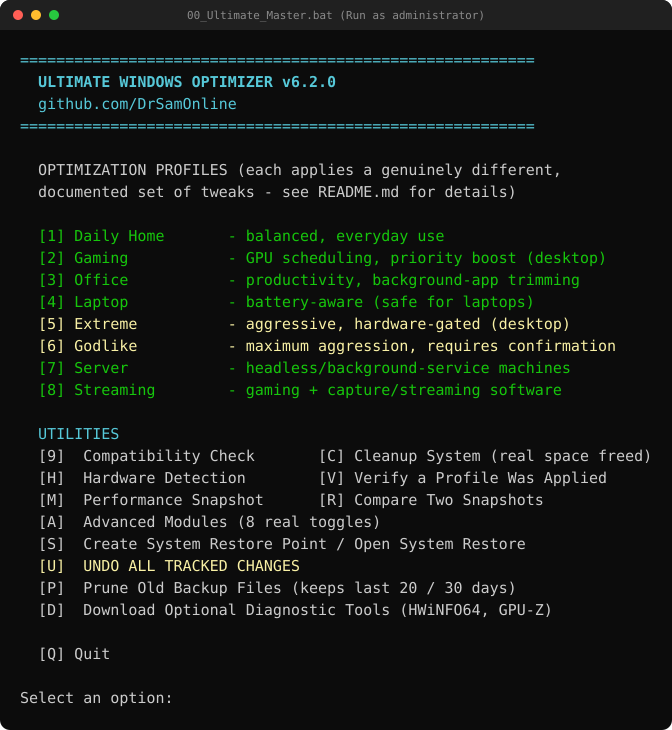
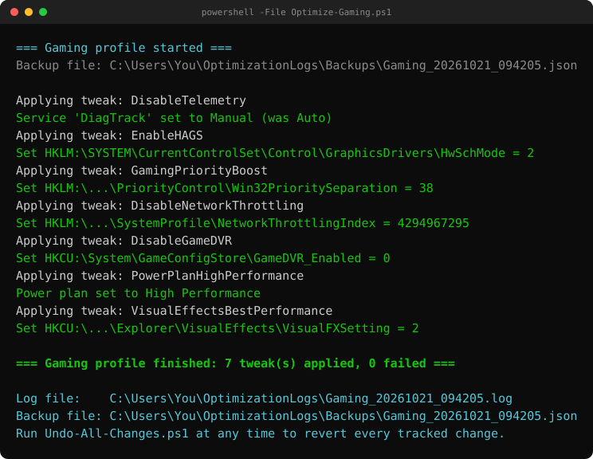
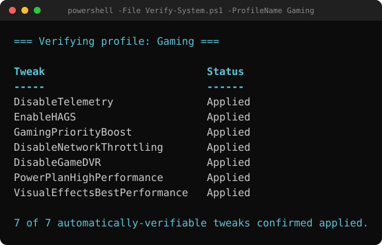
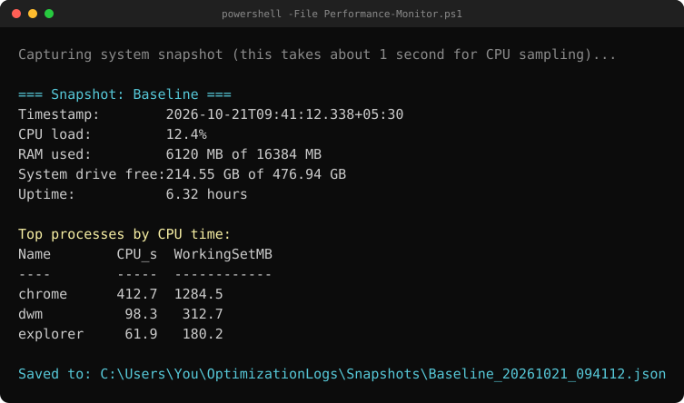

<div align="center">

# ⚡ Ultimate Windows Optimizer

**Debloat Windows to the metal.** — a PowerShell + batch toolkit for documented, **reversible** Windows 10/11 debloat & performance tweaks.

[](https://drsamonline.github.io/ULTIMATE-WINDOWS-OPTIMIZER/)
[](https://github.com/drsamonline/ULTIMATE-WINDOWS-OPTIMIZER)
[](https://github.com/drsamonline/ULTIMATE-WINDOWS-OPTIMIZER/archive/refs/heads/main.zip)

[](https://github.com/drsamonline/ULTIMATE-WINDOWS-OPTIMIZER/stargazers)
[](https://github.com/drsamonline/ULTIMATE-WINDOWS-OPTIMIZER/forks)
[](LICENSE)
[](#requirements)
[](#requirements)
[](CHANGELOG.md)
[](#safety-notes)
[](#safety-notes)

**🔗 [Landing page](https://drsamonline.github.io/ULTIMATE-WINDOWS-OPTIMIZER/)** &nbsp;·&nbsp; **📦 [Repository](https://github.com/drsamonline/ULTIMATE-WINDOWS-OPTIMIZER)** &nbsp;·&nbsp; **⬇️ [Download ZIP](https://github.com/drsamonline/ULTIMATE-WINDOWS-OPTIMIZER/archive/refs/heads/main.zip)** &nbsp;·&nbsp; **🧭 [All projects](https://drsamonline.github.io/)**

</div>

---

<div align="center">

**A PowerShell + batch toolkit for applying documented, reversible Windows performance tweaks — organised into profiles for different use cases.**

[](LICENSE)
[](#requirements)
[](#requirements)
[](CHANGELOG.md)
[](tests)
[](https://github.com/drsamonline/ULTIMATE-WINDOWS-OPTIMIZER/actions/workflows/ci.yml)
[](#safety-notes)
[](#safety-notes)
[](../../pulls)



</div>

---

## What this is (and isn't)

This is a set of well-known, individually-documented Windows tweaks
(disabling telemetry, adjusting CPU priority separation, GPU scheduling,
power plans, visual effects, etc.) wired up with:

- **Real logging** to `%USERPROFILE%\OptimizationLogs`
- **Real backups** of every registry value and service state changed, so
  `Undo-All-Changes.ps1` can put your system back exactly as it was
- **Real verification and benchmarking** utilities that check actual system
  state instead of printing canned numbers

This is **not** a magic performance multiplier. Results depend entirely on
your hardware and workload. No specific percentage improvement is promised
anywhere in this toolkit — use `Performance-Monitor.ps1` before and after to
measure your own real before/after numbers with `Compare-Results.ps1`.

> **Nothing here needs the internet.** The toolkit makes no outbound calls,
> sends no telemetry, and reads no credentials. See [Safety notes](#safety-notes).

---

## Contents

- [Preview](#preview)
- [Requirements](#requirements)
- [Quick start](#quick-start)
- [Profiles — what each one actually does differently](#profiles--what-each-one-actually-does-differently)
- [Utilities](#utilities)
- [What's new in v6.2.0](#whats-new-in-v620)
- [Safety notes](#safety-notes)
- [Development](#development)
- [License](#license)

---

## Preview

> These are faithful renders of the toolkit's real console output (no Windows
> host was used to capture them), shown with representative example values.

<table>
<tr>
<td width="50%"><br><em>Applying a profile — every tweak is logged as it is set.</em></td>
<td width="50%"><br><em>Verify-System checks real state, it does not assume success.</em></td>
</tr>
<tr>
<td width="50%"><br><em>Performance-Monitor saves a real, labeled snapshot.</em></td>
<td width="50%"><br><em>The launcher menu.</em></td>
</tr>
</table>

---

## Requirements

- Windows 10 (build 17763+) or Windows 11
- PowerShell 5.1+ (built in to Windows)
- Administrator rights
- Run `Compatibility-Check.ps1` first (menu option `9`) to confirm your machine meets these

---

## Quick start

1. Extract the ZIP anywhere.
2. Right-click `scripts\00_Ultimate_Master.bat` → **Run as administrator**.
3. Choose option `9` (Compatibility Check) first.
4. Choose option `S` to create a System Restore point (recommended before your first run).
5. Choose option `M` (Performance Snapshot) and label it `Baseline`.
6. Pick a profile (1-8).
7. Optionally take another snapshot (`M`, label it e.g. `AfterGaming`) and run `R` (Compare Two Snapshots) to see real before/after numbers.
8. If you ever want to revert everything this toolkit changed, choose `U` (Undo All Tracked Changes).

---

## Profiles — what each one actually does differently

| Profile | Key tweaks | Notably does NOT do |
|---|---|---|
| **Daily Home** | Disable telemetry, disable Start Menu ads, disable background apps, balanced visual effects, Balanced power plan | No GPU/priority/memory tweaks |
| **Gaming** | GPU hardware scheduling, foreground priority boost, network throttling removed, Game DVR off, High Performance power plan | Not recommended for battery-powered laptops |
| **Office** | Background-app + Xbox-service removal, explicit balanced priority separation | No GPU scheduling or priority boost |
| **Laptop** | USB selective suspend, **disables** HAGS (saves power on hybrid-GPU laptops), Balanced power plan | Never disables hibernation or memory paging |
| **Extreme** | Everything in Gaming + hibernation removed; `DisablePagingExecutive` only if RAM ≥ 16GB; Superfetch disabled only if system drive is confirmed SSD | Desktop only |
| **Godlike** | Everything in Extreme + Windows Search indexing disabled + Xbox services disabled. **Requires typing `CONFIRM`** because it trades away Start-menu/file search speed | Desktop enthusiast machines only |
| **Server** | Disables Search indexing and Xbox services, removes hibernation, favors background-service CPU priority over foreground apps (opposite of Gaming) | No GPU/gaming tweaks |
| **Streaming** | Gaming-profile tweaks + `SystemResponsiveness` lowered so capture/encoding software isn't CPU-starved by the foreground game | - |

Full tweak definitions live in `scripts/UWO.psm1` under `Invoke-Tweak` and the
profile catalog, which is the **single source of truth** for what each profile
does: the profile scripts read their tweak list from it via `Get-ProfileTweak`
instead of keeping their own copy, so the table above, `Verify-System.ps1`, and
what actually runs can no longer drift apart. Read them before running anything
you don't understand.

For the `Extreme` and `Godlike` profiles, `DisablePagingExecutive` and
`DisableSysMain` are listed in the catalog so that `Verify-System.ps1` can
verify them, but the profile scripts strip them from the list they run and
re-append them at runtime, gated on RAM >= 16GB and SSD detection respectively —
so if your hardware doesn't meet the gate, those tweaks are skipped during the
run (and `Verify-System.ps1` will then correctly report them as "Not Applied").

---

## Utilities

- **Compatibility-Check.ps1** — real PASS/FAIL checks (admin rights, OS build, PowerShell version, RAM, disk space, System Restore availability)
- **Hardware-Detection.ps1** — real CPU/GPU/RAM/disk/motherboard info via CIM
- **Performance-Monitor.ps1** — saves a labeled, real snapshot (CPU load, RAM, disk free, top processes)
- **Compare-Results.ps1** — diffs two real snapshots you choose; refuses to run with fewer than 2 snapshots
- **Cleanup-System.ps1** — clears temp/cache/Recycle Bin and reports the actual GB freed (measured, not estimated)
- **Advanced-Modules.ps1** — runs 8 independent tweaks and reports a real success/fail count
- **Verify-System.ps1** — checks current registry/service state against what a chosen profile should have applied
- **System-Rollback.ps1** — creates a real Windows System Restore point, or opens System Restore
- **Undo-All-Changes.ps1** — reads every backup file this toolkit has written and restores every tracked registry value, service, and hibernation setting to its original state
- **Cleanup-Backups.ps1** (menu `P`) — prunes old backup JSON files that would otherwise accumulate forever. Conservative by design: a file is deleted only if it is **both** outside the newest 20 files **and** older than 30 days, and backups that have not been undone yet are never touched unless you pass `-IncludePending`. Use `-WhatIf` to preview, `-KeepCount`/`-MaxAgeDays` to change the thresholds; everything pruned is logged

---

## What's new in v6.2.0

A correctness-and-polish release driven by an independent code audit. The undo
guarantee now holds for **services, power plans and hibernation**, not just
registry values.

- **Undo now restores services and power plans after a re-run.** Previously,
  re-running a profile recorded the already-tweaked service start mode / power
  plan as the "original", and those record types were not de-duplicated — so
  "Undo All" could leave the machine on the tweaked state. `Set-ServiceStateSafe`
  and the `PowerPlan*` tweaks are now idempotent, and
  `Select-BackupRecordsToRestore` de-duplicates services (per service),
  power plans and hibernation as well as registry values, keeping the earliest
  recorded original.
- **`Verify-System.ps1` now reports `DisableNetworkThrottling` correctly.**
  The value `0xffffffff` reads back as `-1`; the verifier now uses the same
  normalising comparison as the write path (`Test-RegistryValueMatch`).
- **Service backups are written only after the change succeeds**, matching the
  registry path.
- **Hibernation is state-aware.** If hibernation is already off, nothing is
  changed and nothing is recorded; undo restores the state that was actually
  captured.
- **`EnableUSBSelectiveSuspend` now does what its name says.** The old version
  wrote `CsEnabled` (the Connected/Modern Standby flag). It now sets the real
  per-scheme USB selective-suspend setting for the active power plan, and is
  verified against the active scheme.
- **Importing the module no longer creates folders.** Log/backup/snapshot
  directories are created lazily on first write, so a read-only utility or a
  `-WhatIf` preview leaves no trace.
- **`VisualEffectsBalanced`** now writes `0` ("Let Windows choose" — the actual
  balanced default) instead of `3` ("Custom").
- **`Compare-Results.ps1`** validates your snapshot selection instead of
  silently comparing blanks.
- **Launcher renamed** to `00_Ultimate_Master.bat` (no version in the filename).

See [`CHANGELOG.md`](CHANGELOG.md) for the full history.

---

## Safety notes

- The previous state of every registry value, Windows service, hibernation
  setting, and power plan is captured **before** the change and written to a per-run JSON backup file **as soon as the change actually succeeds**. A failed change writes no backup record, so `Undo-All-Changes.ps1` can never try to "restore" something that was never applied. (Services originally in `Boot`/`System` start modes — kernel drivers — cannot be restored via `Set-Service` and are logged with a clear warning instead.)
- **Re-running a profile is a no-op for anything that already matches.** Nothing is written and no backup record is added, so a second run cannot record an already-tweaked value as your "original" one. As a second line of defence, undo de-duplicates records across all backup files by their logical target and always restores the *earliest* recorded original.
- **Registry keys created by the toolkit are removed again on undo** — but only when the value did not exist beforehand, the key was created by this toolkit, and the key is still empty. A key that something else has since written to is left in place.
- `Undo-All-Changes.ps1` supports `-WhatIf` to preview what it would restore without changing anything, and tolerates corrupted/empty backup files without aborting the whole undo run.
- Power plans are restored locale-independently: the plan GUID is extracted and stored when it is captured, rather than re-parsed from localized `powercfg` output at undo time.
- Backup files are never deleted automatically. Pruning only happens when you run `Cleanup-Backups.ps1` (menu `P`), and by default it leaves every backup that has not been undone yet alone.
- The `Godlike` profile requires typed confirmation because it disables Windows Search indexing, which has a real usability cost.
- The optional dependency downloader (menu `D`) only opens official vendor download pages — it does not silently run anything, and does not claim to verify file signatures for you.
- **No network, no telemetry, no credential access, no persistence.** The toolkit contains no downloader, no `Invoke-Expression`, no scheduled tasks and no security-product changes.

---

## Development

The shared engine is the `UWO` module (`scripts/UWO.psm1` + `scripts/UWO.psd1`).
Scripts consume it with `Import-Module (Join-Path $PSScriptRoot 'UWO.psd1')`;
`scripts/Common-Functions.ps1` remains only as a shim that imports the module
and re-publishes the old `$Global:*` catalog variables, so anything that still
dot-sources it keeps working.

Tests live in `tests/` and run with Pester 5:

```powershell
Install-Module Pester -RequiredVersion 5.7.1 -Scope CurrentUser
Invoke-Pester -Path ./tests
```

The registry tests only ever touch `HKCU:\Software\UWO-Test` and are skipped on
non-Windows hosts; logs/backups are redirected to a temporary directory via the
`UWO_LOG_ROOT` environment variable, so running the suite never touches
`%USERPROFILE%\OptimizationLogs`. Lint with
`Invoke-ScriptAnalyzer -Path . -Recurse -Settings ./PSScriptAnalyzerSettings.psd1`;
both run automatically on `windows-latest` under Windows PowerShell 5.1 in CI
(see [`.github/workflows/ci.yml`](.github/workflows/ci.yml)).

---

## License

BSD 3-Clause. See [`LICENSE`](LICENSE).

Created by **Dr. Sohil Momin** (Coding For Fun / [@DrSamOnline](https://github.com/DrSamOnline)).
